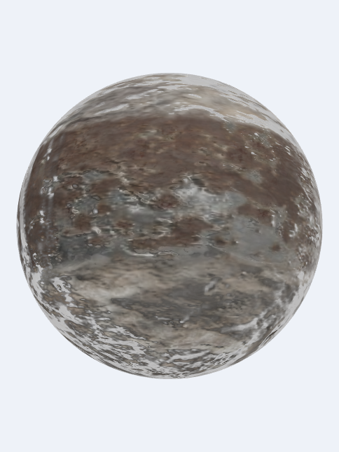

# 6주차 — PBR 재질과 표면 마스크

## 실행 페이지

- [실습 1 — 텍스처 기반 PBR 재질](https://kimjte3413-boop.github.io/CG-2026-solarsystem/week6/task1.html)
- [실습 2 — 조건부 행성 표면 마스크](https://kimjte3413-boop.github.io/CG-2026-solarsystem/week6/task2.html)

## 실습 1 — 텍스처 기반 PBR

### 의도와 구현

큐브의 각 면에 Poly Haven 재질을 적용하고, Diffuse 색상과 데이터 맵이 조명에 미치는 차이를 비교합니다. Diffuse 텍스처는 sRGB에서 선형 공간으로 변환하고, ARM은 R=AO, G=roughness, B=metallic 순서로 해석합니다. 데이터 맵에는 sRGB 변환을 하지 않습니다. GGX 분포와 Schlick Fresnel/Smith 기하항으로 직접광을 계산하고, AO가 적용된 상수 ambient와 roughness 밉맵을 사용하는 환경 반사를 별도 기여로 더합니다. 노멀 맵은 화면 미분으로 TBN을 구성해 적용합니다.

### 관찰 기록

- 녹슨 금속: 표면의 얼룩과 요철이 Diffuse/normal 맵에 따라 보이고, 낮은 roughness 영역의 직접광 및 환경 반사가 밝은 하이라이트로 나타납니다.
- 나무·돌: 재질 선택을 바꾸면 베이스 색과 거칠기/금속성 응답이 달라집니다. `roughness`, `metallic`, `normal`, 직접광, ambient, 환경 반사 슬라이더를 각각 움직여 차이를 확인할 수 있습니다.
- 직접광 세기를 낮춰도 ambient와 환경 반사의 기여는 남으며, 환경 반사 세기를 낮추면 그 반사 성분만 줄어듭니다.

## 실습 2 — 위도·세부값 조건 표면 마스크

### 의도와 구현

UV 구형 행성의 바탕에는 돌 재질을, 마스크 영역에는 녹슨 금속 재질을 섞어 두 재질의 PBR 반응을 비교합니다. 첫 조건은 오브젝트 공간의 위도 좌표 abs(y)가 조절 가능한 경계 안에 드는지 여부이고, 두 번째 조건은 Diffuse 텍스처 세부 밝기입니다. 두 조건을 결합해 금속 무늬 마스크를 만들고, 선택된 영역에서 베이스 색·ARM 값·접선 공간 노멀을 함께 블렌딩합니다. 위도 경계와 세부 조건 슬라이더로 분포를 바꿀 수 있습니다.

### 관찰 기록

- 위도 경계를 낮추면 금속 마스크가 좁은 적도 띠에 모이고, 높이면 더 넓은 위도 범위로 확장됩니다.
- 표면 세부 조건을 바꾸면 위도 마스크 안의 금속 무늬가 Diffuse 텍스처 밝기와 함께 분리됩니다.
- 금속 영역은 돌 영역보다 확산 반사가 줄고 정반사/환경 반사가 더 두드러집니다.

## 이미지 출처와 라이선스

Diffuse, normal, ARM 재질 맵 및 `studio_small_09_tonemapped.jpg` 환경 이미지는 [Poly Haven](https://polyhaven.com/)의 CC0 자산입니다. 파일별 원본 URL과 처리 내역은 [`assets/week06/sources.json`](assets/week06/sources.json)에 기록했습니다. 캡처 이미지는 이 실습 페이지의 실행 화면입니다.

## AI 활용 및 검증

- AI 활용: 시작 코드의 PBR 셰이더 구현 및 보고서/실행 페이지 정리에 사용했습니다.
- 직접 판단: 데이터 맵 선형 샘플링, direct/ambient/environment 분리, ARM 채널 배치와 표면 마스크 조건을 확인했습니다.
- 검증: 각 페이지에서 텍스처 로딩 완료, WebGL 셰이더 렌더링, 재질 또는 마스크 슬라이더 반응을 확인했습니다.
