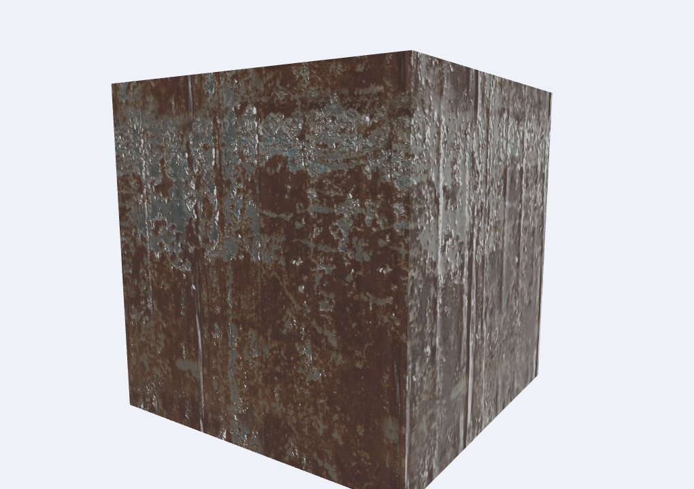
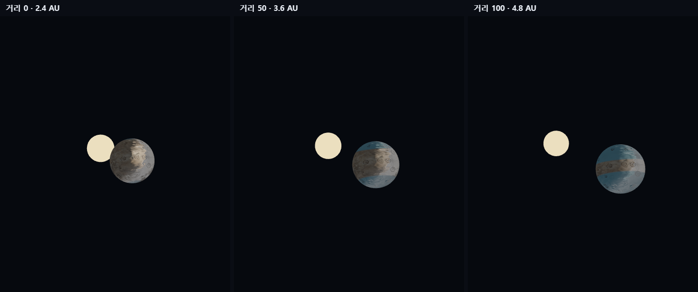
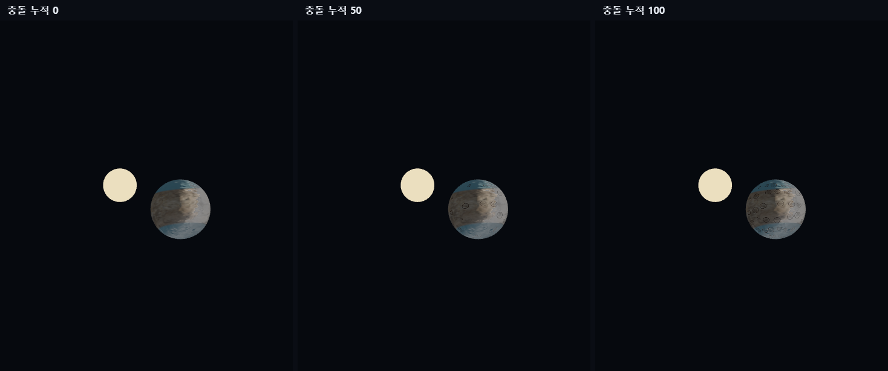
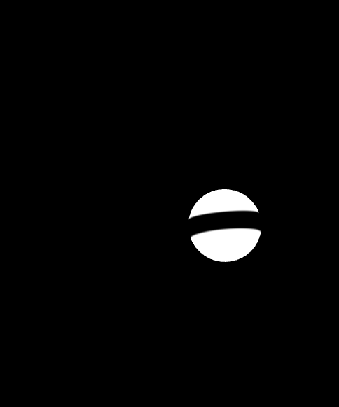
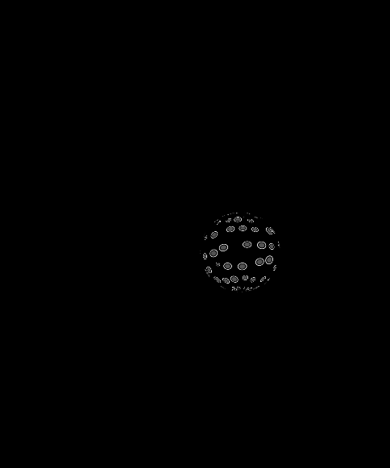
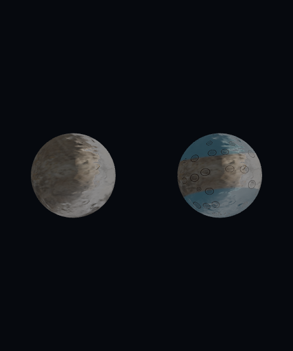

# 6주차 — PBR 재질과 표면 마스크

## 실행 페이지

- [실습 1 — 텍스처 기반 PBR 재질](https://kimjte3413-boop.github.io/CG-2026-solarsystem/week6/task1.html)
- [실습 2 — 조건부 행성 표면 마스크](https://kimjte3413-boop.github.io/CG-2026-solarsystem/week6/task2.html)

## 실습 1 — 텍스처 기반 PBR

### 의도와 구현

큐브의 각 면에 Poly Haven 재질을 적용하고, Diffuse 색상과 데이터 맵이 조명에 미치는 차이를 비교합니다. Diffuse 텍스처는 sRGB에서 선형 공간으로 변환하고, ARM은 R=AO, G=roughness, B=metallic 순서로 해석합니다. 데이터 맵에는 sRGB 변환을 하지 않습니다. GGX 분포와 Schlick Fresnel/Smith 기하항으로 직접광을 계산하고, AO가 적용된 상수 ambient와 roughness 밉맵을 사용하는 환경 반사를 별도 기여로 더합니다. 노멀 맵은 화면 미분으로 TBN을 구성해 적용합니다.

### 관찰 기록

- 녹슨 금속: 표면의 얼룩과 요철이 Diffuse/normal 맵에 따라 보이고, 낮은 roughness 영역의 직접광 및 환경 반사가 밝은 하이라이트로 나타납니다.
- 나무·돌: 재질 선택을 바꾸면 베이스 색과 거칠기/금속성 응답이 달라집니다. `roughness`, `metallic`, `normal`, 직접광, ambient, 환경 반사 슬라이더를 각각 움직여 차이를 확인할 수 있습니다.
- 직접광 세기를 낮춰도 ambient와 환경 반사의 기여는 남으며, 환경 반사 세기를 낮추면 그 반사 성분만 줄어듭니다.

## 실습 2 — 위도·세부값 조건 표면 마스크

### 의도와 구현

새 행성 **니바(Niva)**를 태양과 함께 만들었습니다. 구형 행성은 태양을 공전하고 자전하며, 태양과 행성 사이의 거리 설정은 행성의 궤도 위치와 행성 표면에 도달하는 빛의 거리 감쇠에 함께 연결됩니다. 휠/드래그로 시점을 바꾸고 `자전·공전 멈춤`을 눌러 고정 비교할 수 있습니다.

| 환경·사건 원인 | 장면 변수와 위치별 규칙 | 표면 재질 반응 |
|---|---|---|
| 태양 거리 · `solar-condition` | `task2.js`의 `climateMask`: `abs(vLocal.y)`로 위도를 구하고 `uSolarCondition`으로 얼음 경계를 `.96`에서 `.26`까지 이동시킵니다. 같은 조건으로 궤도 반경을 2.4–4.8 장면 단위로 바꾸고, 직접광은 태양까지 거리의 제곱으로 감쇠합니다. | 극지 얼음 색과 높은 roughness가 차가운 영역에 넓어집니다. |
| 충돌 누적 · `impact-amount` | `task2.js`의 `impactMask`: UV 셀별 해시로 고정된 충돌 중심·반경·테두리를 만들고, 누적량이 커질수록 표시되는 충돌 수를 연속적으로 늘립니다. | 독립적인 어두운 크레이터와 밝은 테두리를 색에 섞고 충돌부 roughness를 높입니다. |

행성은 돌 `Diffuse`, `nor_gl`, `ARM` 맵을 바탕으로 씁니다. ARM은 R=AO, G=roughness, B=metallic이며 데이터 맵은 선형 값 그대로 읽습니다. 위치는 로컬 좌표 `vLocal`, 직접광과 카메라·환경 반사는 월드 좌표 `vP`를 사용하고, `uNormalMat`으로 법선을 월드 좌표로 변환합니다. 실습 1의 GGX PBR·TBN 노멀 계산을 이어서 적용했습니다.

`표면 보기`에서 마스크 1·2를 각각 흑백으로 진단하고, `기본/변화 비교`에서 같은 프레임의 미변화 표면과 두 마스크 적용 결과를 좌우로 비교할 수 있습니다.

### 관찰 기록

- 태양 거리 0 → 50 → 100에서 행성은 별에서 멀어지고 직접광이 감소하며, 흑백 진단 화면에서 극지 서리 마스크가 확장됩니다.
- 충돌 누적 0 → 50 → 100에서 서리 조건을 고정해도 크레이터 중심과 테두리 패턴의 밀도만 증가합니다.
- 비교 화면은 카메라·광원·자전 위상을 공유합니다. 얼음·충돌 영역은 기본 돌 영역보다 반사와 거칠기가 달라져 색뿐 아니라 표면 하이라이트도 변합니다.

**태양 거리 변화 (충돌 누적 50 고정)**

**충돌 누적 변화 (태양 거리 조건 50 고정)**

**각 마스크 흑백 진단과 기본/변화 비교**

| 극지 서리 마스크 | 충돌 흔적 마스크 | 기본 표면과 변경 표면 |
|---|---|---|
|  |  |  |

## 이미지 출처와 라이선스

Diffuse, normal, ARM 재질 맵 및 `studio_small_09_tonemapped.jpg` 환경 이미지는 [Poly Haven](https://polyhaven.com/)의 CC0 자산입니다. 파일별 원본 URL과 처리 내역은 [`assets/week06/sources.json`](assets/week06/sources.json)에 기록했습니다. 캡처 이미지는 이 실습 페이지의 실행 화면입니다.

## AI 활용 및 검증

- AI 활용: 실습 1 PBR 코드를 태양계 행성에 이식하고, 두 원인·마스크·진단 및 비교 기능을 단계적으로 구현하는 데 사용했습니다.
- 직접 판단: 로컬 좌표 위도는 자전해도 행성 표면에 고정하고, 월드 위치는 광원·시점 계산에 사용했습니다. 데이터 맵은 선형으로 샘플링하며 base/변경 비교는 한 시점에서 그리도록 했습니다.
- 검증: 두 조건을 각각 0·50·100으로 바꾸고, 마스크별 흑백 화면과 좌우 비교를 확인했습니다. 광원 거리 변경에 따른 행성 위치/직접광, 자전·공전 정지, 재질 텍스처 로딩과 WebGL 셰이더 동작도 확인했습니다.
